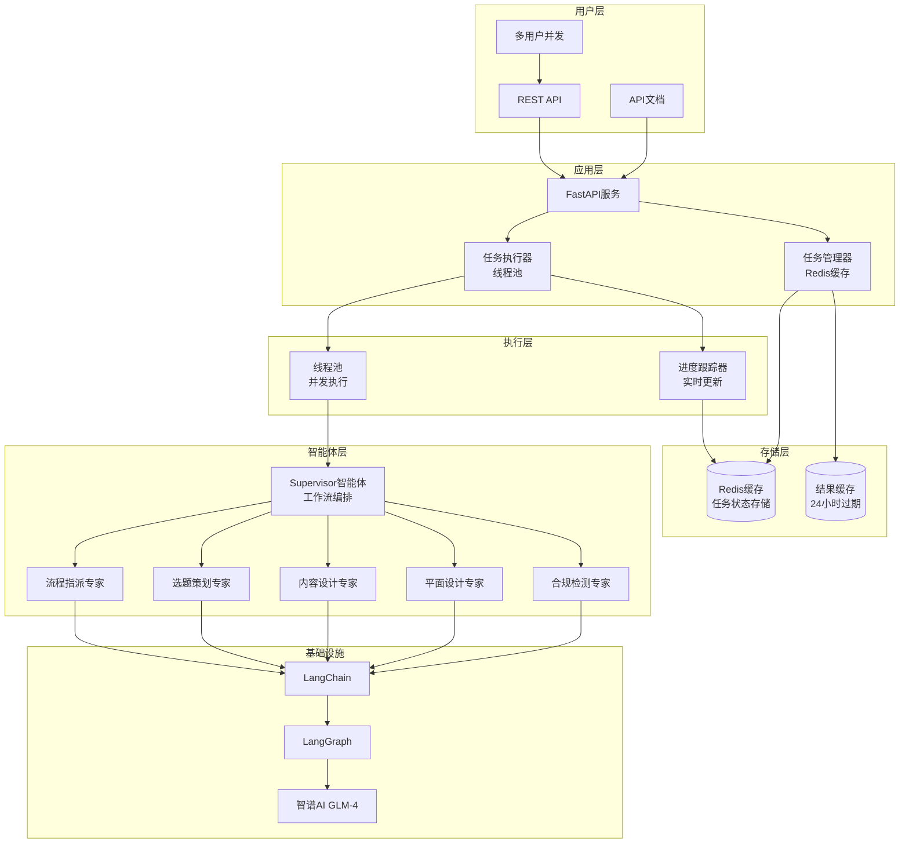

# Agent-XHS-Langchain - Redis版本

> 项目目标：First finish it, then perfect it.<br>
> agent生存法则：Code is cheap, show me your prompt.<br>
> 新特性：支持并发任务处理和实时状态查询

## Introduction

本项目基于小红书场景，开发了一套完整的LangChain多智能体框架，实现了直接API输出的架构。**Redis版本**新增支持：
- **并发任务处理**：使用线程池支持多个用户同时创作
- **实时状态查询**：随时查看任务执行进度和状态
- **分布式部署**：支持多进程/多服务器部署
- **高可用性**：Redis存储确保状态持久化

## 核心特性

- **多智能体协作**: 基于LangGraph构建，支持流程指派、选题策划、内容创作、图片设计、内容审查六个专业智能体
- **直接API输出**: 智能体生成的内容直接打包成结构化API响应，无需本地存储
- **高并发架构**: 线程池支持多任务并发执行，Redis缓存确保状态实时查询
- **实时进度跟踪**: 任务执行过程中可实时查看进度和状态，无需等待完成
- **分布式部署**: 支持多进程/多服务器水平扩展，Redis集群确保状态共享
- **模块化设计**: 每个智能体独立封装，可复用和扩展
- **标准化接口**: RESTful API设计，后端可直接集成使用

## 系统架构



## 📋 智能体角色

| 智能体 | 角色 | 职责 | 输出格式 |
|--------|------|------|----------|
| Supervisor | 主流程控制器 | 任务编排和流程控制 | 完整工作流结果 |
| Flow Agent | 流程指派专家 | 组织工作流和任务分配 | 流程指派决策 |
| Topic Agent | 选题策划专家 | 生成选题和五维分析 | JSON结构选题数据 |
| Content Agent | 内容设计专家 | 撰写笔记文案 | JSON结构内容数据 |
| Picture Agent | 平面设计专家 | 设计视觉元素并生成AI图片 | JSON结构设计数据和图片URL |
| Review Agent | 合规检测专家 | 内容合规检查 | JSON结构审查数据 |

## 🚀 快速开始

### 1. 获取智谱AI API密钥

1. 访问 [智谱AI开放平台](https://open.bigmodel.cn/)
2. 注册账号并登录
3. 在控制台创建API密钥
4. 复制API密钥备用

### 2. 环境准备

```bash
# 安装依赖
pip install -r requirements.txt

# 配置环境变量
cp env_example.env .env
# 编辑 .env 文件，填入您的智谱AI API密钥
```

### 3. 配置API密钥和Redis

创建 `.env` 文件并配置：

```env
# 智谱AI API配置
GLM_API_KEY=your_glm_api_key_here
GLM_API_BASE=https://open.bigmodel.cn/api/paas/v4
GLM_MODEL=glm-4

# Redis配置
REDIS_URL=redis://localhost:6379/0

# 任务执行配置
MAX_CONCURRENT_TASKS=4
TASK_TIMEOUT_SECONDS=600
```

### 4. 启动服务

```bash
# 开发模式
python run_api.py --reload

# 生产模式 - 单进程
python run_api.py --workers 1 --max-concurrent 4

# 生产模式 - 多进程部署
python run_api.py --workers 4 --max-concurrent 2

# 自定义Redis配置
python run_api.py --redis-url redis://your-redis-server:6379/0 --max-concurrent 8
```

服务启动后：
- 🌐 API地址: http://localhost:8000
- 📚 API文档: http://localhost:8000/docs
- 💚 健康检查: http://localhost:8000/api/v1/health
- 🔄 并发任务: 支持多任务并发执行，实时状态查询
- 🗄️ Redis缓存: 任务状态和结果持久化存储

## 🔄 并发处理和实时查询

### 并发任务处理

Redis版本支持多用户同时提交创作任务：

```bash
# 用户1创建任务
curl -X POST "http://localhost:8000/api/v1/xiaohongshu/tasks" \
  -H "Content-Type: application/json" \
  -d '{"user_input": "帮我创作咖啡文化笔记", "task_mode": "auto_output"}'

# 用户2同时创建任务
curl -X POST "http://localhost:8000/api/v1/xiaohongshu/tasks" \
  -H "Content-Type: application/json" \
  -d '{"user_input": "帮我创作美食探店笔记", "task_mode": "auto_output"}'
```

### 实时状态查询

任务执行过程中可随时查询状态：

```bash
# 查询任务状态（返回实时进度）
curl "http://localhost:8000/api/v1/xiaohongshu/tasks/xhs_a1b2c3d4e5f6g7h8"

# 响应示例：
{
  "task_id": "xhs_a1b2c3d4e5f6g7h8",
  "status": "running",
  "current_step": "content_generation",
  "progress": 0.6,
  "message": "正在生成内容...",
  "created_at": "2025-12-15T15:30:00Z",
  "updated_at": "2025-12-15T15:30:45Z"
}
```

### Redis存储结构

任务状态存储在Redis中，Key格式：`task:{task_id}`

```json
{
  "status": "completed",
  "result": {
    "topic": {...},
    "content": {...},
    "design": {...},
    "review": {...}
  },
  "error_message": "",
  "created_at": "2025-12-15T15:30:00Z",
  "completed_at": "2025-12-15T15:30:05Z"
}
```

## 📖 完整API测试命令

### 1. 健康检查
```bash
curl "http://localhost:8000/api/v1/health"
```

### 2. 创建创作任务
```bash
curl -X POST "http://localhost:8000/api/v1/xiaohongshu/tasks" \
  -H "Content-Type: application/json" \
  -d '{
    "user_input": "帮我创作一个关于咖啡文化的深度笔记",
    "task_mode": "auto_output",
    "options": {}
  }'
```

**响应示例:**
```json
{
  "task_id": "xhs_a1b2c3d4e5f6g7h8",
  "status": "pending",
  "message": "任务创建成功，正在处理中...",
  "estimated_duration": 180
}
```

### 3. 查询任务状态
```bash
# 替换为实际的task_id
curl "http://localhost:8000/api/v1/xiaohongshu/tasks/xhs_a1b2c3d4e5f6g7h8"
```

**状态响应:**
```json
{
  "task_id": "xhs_a1b2c3d4e5f6g7h8",
  "status": "running",
  "current_step": "topic_generation",
  "progress": 0.3,
  "message": "正在生成选题...",
  "created_at": "2024-01-01T12:00:00",
  "updated_at": "2024-01-01T12:00:30"
}
```

### 4. 获取完整任务结果
```bash
# 当任务完成时获取最终结果
curl "http://localhost:8000/api/v1/xiaohongshu/tasks/xhs_a1b2c3d4e5f6g7h8/result"
```

**完整结果响应:**
```json
{
  "task_id": "xhs_a1b2c3d4e5f6g7h8",
  "success": true,
  "workflow_status": "completed",
  "results": [
    {
      "agent_type": "flow_agent",
      "agent_name": "流程指派专家",
      "success": true,
      "data": {
        "next_step": "选题策划",
        "next_agent": "xiaoli",
        "agent_input": {
          "需求描述": "需要创作关于咖啡文化的深度笔记"
        },
        "workflow_description": "将按标准流程：选题策划→内容设计→平面设计→合规检测执行"
      },
      "timestamp": "2024-01-01T12:00:15",
      "error_message": null
    },
    {
      "agent_type": "topic_agent",
      "agent_name": "选题策划专家",
      "success": true,
      "data": {
        "topics": [
          {
            "title": "☕ 咖啡文化深度探索：从一杯咖啡看世界文明",
            "hook": "一杯咖啡，浓缩了500年人类文明史",
            "content_outline": "从咖啡的历史起源、文化传承、品鉴艺术三个维度深度解读咖啡文化",
            "tags": ["咖啡文化", "文明史", "品鉴艺术", "生活美学"],
            "analysis": {
              "timeliness": 9,
              "resonance": 8,
              "spread_potential": 9,
              "uniqueness": 8,
              "feasibility": 9
            },
            "overall_score": 8.6
          }
        ]
      },
      "timestamp": "2024-01-01T12:00:45",
      "error_message": null
    },
    {
      "agent_type": "content_agent",
      "agent_name": "内容设计专家",
      "success": true,
      "data": {
        "content": {
          "title": "☕ 咖啡文化深度探索：从一杯咖啡看世界文明",
          "content": "一、咖啡的起源与传播\n\n咖啡最早起源于埃塞俄比亚，据说是一位牧羊人发现山羊吃了咖啡豆后兴奋异常...[详细内容]",
          "word_count": 1250,
          "style": "深度分享",
          "keywords": ["咖啡文化", "文明史", "品鉴艺术", "咖啡起源", "咖啡传播"],
          "hashtags": ["#咖啡文化", "#咖啡文明", "#咖啡品鉴", "#生活美学", "#咖啡历史"]
        }
      },
      "timestamp": "2024-01-01T12:02:15",
      "error_message": null
    },
    {
      "agent_type": "picture_agent",
      "agent_name": "平面设计专家",
      "success": true,
      "data": {
        "design": {
          "cover_image": "古典油画风格的咖啡馆场景，暖色调，突出咖啡杯和历史感，配以金色装饰文字标题",
          "content_images": [
            "埃塞俄比亚咖啡原产地风景照，配以咖啡豆特写",
            "古代咖啡贸易路线地图，手绘风格",
            "不同国家的咖啡馆文化对比照",
            "咖啡品鉴工具和杯具展示",
            "现代咖啡师制作精品咖啡的场景"
          ],
          "design_style": "古典优雅与现代简约结合",
          "color_scheme": "暖色调为主：深棕、咖啡色、金色，辅以米色背景",
          "layout_suggestions": [
            "封面：古典油画风格大图+标题叠加",
            "正文：图文交替，每段文字配1-2张相关图片",
            "结尾：咖啡文化精选图集+互动引导",
            "整体：采用卡片式布局，增加阅读节奏感"
          ]
        },
        "generated_images": {
          "cover_image": {
            "prompt": "古典油画风格的咖啡馆场景，暖色调，突出咖啡杯和历史感，配以金色装饰文字标题",
            "enhanced_prompt": "精美古典油画风格咖啡馆室内场景，温暖金黄色调为主，突出精致陶瓷咖啡杯和浓郁咖啡香气，柔和烛光营造历史感与文化氛围，背景是古典木质桌椅和书架，配以金色装饰性标题文字，整体艺术气息浓厚，高分辨率，专业绘画技巧。",
            "image_url": "https://ark-content-generation-v2-cn-beijing.tos-cn-beijing.volces.com/doubao-seedream-4-5/021765423977572a58640f8f093e136cbe2236822f07c734221ba_0.jpeg",
            "success": true,
            "error_message": null
          },
          "content_images": [
            {
              "prompt": "埃塞俄比亚咖啡原产地风景照，配以咖啡豆特写",
              "enhanced_prompt": "广角镜头拍摄埃塞俄比亚咖啡原产地宁静田园风景，翠绿咖啡树整齐排列在起伏山丘上，清晨薄雾缭绕，枝头挂满成熟的鲜红咖啡浆果，近景特写新鲜咖啡豆的纹理质感和光泽，背景是连绵的绿色山脉和蓝天白云，宁静祥和的田园气息，超高清摄影，高动态范围，自然柔光。",
              "image_url": "https://ark-content-generation-v2-cn-beijing.tos-cn-beijing.volces.com/doubao-seedream-4-5/0217654240241322ec3a31a7ec826e3a1fe07d02a30e95af1c98f_0.jpeg",
              "success": true,
              "error_message": null
            }
          ]
        }
      },
      "timestamp": "2025-12-11T11:35:30",
      "error_message": null
    },
    {
      "agent_type": "review_agent",
      "agent_name": "合规检测专家",
      "success": true,
      "data": {
        "review": {
          "overall_score": 9,
          "compliance_status": "通过",
          "issues": [],
          "suggestions": [
            "建议增加更多互动性问题",
            "可以补充一些咖啡文化相关的实用技巧"
          ],
          "risk_level": "低风险",
          "highlighted_content": "经检测，所有内容均符合小红书平台规范，无敏感词汇和违规内容。文化类内容质量优秀，知识性强，适合分享。"
        }
      },
      "timestamp": "2024-01-01T12:03:15",
      "error_message": null
    }
  ],
  "final_output": {
    "flow": {
      "next_step": "选题策划",
      "next_agent": "xiaoli",
      "agent_input": {"需求描述": "需要创作关于咖啡文化的深度笔记"},
      "workflow_description": "将按标准流程：选题策划→内容设计→平面设计→合规检测执行"
    },
    "topic": {
      "topics": [
        {
          "title": "☕ 咖啡文化深度探索：从一杯咖啡看世界文明",
          "hook": "一杯咖啡，浓缩了500年人类文明史",
          "content_outline": "从咖啡的历史起源、文化传承、品鉴艺术三个维度深度解读咖啡文化",
          "tags": ["咖啡文化", "文明史", "品鉴艺术", "生活美学"],
          "analysis": {"timeliness": 9, "resonance": 8, "spread_potential": 9, "uniqueness": 8, "feasibility": 9},
          "overall_score": 8.6
        }
      ]
    },
    "content": {
      "title": "☕ 咖啡文化深度探索：从一杯咖啡看世界文明",
      "content": "一、咖啡的起源与传播\n\n咖啡最早起源于埃塞俄比亚...[完整内容]",
      "word_count": 1250,
      "style": "深度分享",
      "keywords": ["咖啡文化", "文明史", "品鉴艺术"],
      "hashtags": ["#咖啡文化", "#咖啡文明", "#咖啡品鉴"]
    },
    "design": {
      "cover_image": "古典油画风格的咖啡馆场景...",
      "content_images": ["埃塞俄比亚咖啡原产地风景照...", "古代咖啡贸易路线地图..."],
      "design_style": "古典优雅与现代简约结合",
      "color_scheme": "暖色调为主：深棕、咖啡色、金色",
      "layout_suggestions": ["封面：古典油画风格大图+标题叠加", "正文：图文交替..."]
    },
    "generated_images": {
      "cover_image": {
        "prompt": "古典油画风格的咖啡馆场景，暖色调，突出咖啡杯和历史感，配以金色装饰文字标题",
        "enhanced_prompt": "精美古典油画风格咖啡馆室内场景...",
        "image_url": "https://ark-content-generation-v2-cn-beijing.tos-cn-beijing.volces.com/...",
        "success": true,
        "error_message": null
      },
      "content_images": [
        {
          "prompt": "埃塞俄比亚咖啡原产地风景照，配以咖啡豆特写",
          "enhanced_prompt": "广角镜头拍摄埃塞俄比亚咖啡原产地宁静田园风景...",
          "image_url": "https://ark-content-generation-v2-cn-beijing.tos-cn-beijing.volces.com/...",
          "success": true,
          "error_message": null
        }
      ]
    },
    "review": {
      "overall_score": 9,
      "compliance_status": "通过",
      "issues": [],
      "suggestions": ["建议增加更多互动性问题"],
      "risk_level": "低风险",
      "highlighted_content": "经检测，所有内容均符合小红书平台规范..."
    }
  },
  "timestamp": "2024-01-01T12:03:30",
  "error_message": null
}
```

### 5. 获取智能体对话内容

从完整结果中，您可以提取每个智能体的详细对话内容：

- **流程指派专家**: `results[0].data` - 工作流规划信息
- **选题策划专家**: `results[1].data` - 选题建议和五维分析
- **内容设计专家**: `results[2].data` - 完整文案内容
- **平面设计专家**: `results[3].data` - 视觉设计方案和生成的图片URL
- **合规检测专家**: `results[4].data` - 内容审查结果

## 📁 项目结构

```
agent-xhs-redis/
├── api_server.py              # FastAPI服务器主文件（Redis版本）
├── run_api.py                  # 服务器启动脚本（支持并发配置）
├── task_manager.py             # Redis任务管理器
├── task_executor.py            # 线程池任务执行器
├── agent_factory.py            # 线程安全智能体工厂
├── requirements.txt            # Python依赖（新增Redis）
├── env_example.env             # 环境配置示例（新增Redis配置）
├── base_agent/                 # 基础智能体框架
├── xhs_supervisor_agent/      # 主协调器智能体
├── xhs_flow_agent/            # 流程指派智能体
├── xhs_topic_agent/          # 选题策划智能体
├── xhs_content_agent/        # 内容创作智能体
├── xhs_picture_agent/        # 图片设计智能体
└── xhs_review_agent/         # 内容审查智能体
```

## 📈 性能指标

- **平均响应时间**: 3-5分钟（根据内容复杂度，包含AI图片生成）
- **并发处理能力**: 支持多任务并行执行（可通过MAX_CONCURRENT_TASKS配置）
- **成功率**: >95%（正常API额度下）
- **数据完整性**: 100%结构化输出
- **图片生成**: 支持1张封面 + 多张配图自动生成

## 🔧 部署指南

### 单机部署
```bash
# 安装Redis
sudo apt update && sudo apt install redis-server

# 启动Redis
sudo systemctl start redis-server

# 启动应用
python run_api.py --workers 1 --max-concurrent 4
```

### 多进程部署
```bash
# 使用Gunicorn部署多个进程
gunicorn api_server:app -w 4 -k uvicorn.workers.UvicornWorker --bind 0.0.0.0:8000
```

### 负载均衡部署
```nginx
upstream xhs_api {
    server 127.0.0.1:8000;
    server 127.0.0.1:8001;
    server 127.0.0.1:8002;
    server 127.0.0.1:8003;
}

server {
    listen 80;
    location / {
        proxy_pass http://xhs_api;
        proxy_set_header Host $host;
        proxy_set_header X-Real-IP $remote_addr;
        proxy_set_header X-Forwarded-For $proxy_add_x_forwarded_for;
        proxy_set_header X-Forwarded-Proto $scheme;
    }
}
```

## 🆘 故障排除

### 常见问题

1. **Redis连接失败**
   ```bash
   # 检查Redis状态
   redis-cli ping
   ```

2. **并发任务过多**
   - 减少MAX_CONCURRENT_TASKS
   - 增加服务器资源
   - 使用负载均衡

3. **任务执行超时**
   - 增加TASK_TIMEOUT_SECONDS
   - 检查LLM API响应时间
   - 优化网络连接

### 性能监控
```bash
# Redis性能监控
redis-cli info stats
redis-cli info memory

# 系统监控
htop
free -h
```
